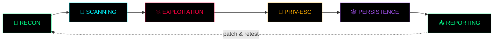

<!-- ═══════════════════════ HERO / BOOT ═══════════════════════ -->
<div align="center">


<br/>


<br/><br/>


</div>

```text
   ▄████████    ▄████████    ▄████████    ▄████████    ▄████████    ▄████████    ▄███████▄
  ███    ███   ███    ███   ███    ███   ███    ███   ███    ███   ███    ███   ██▀     ▄██
  ███    █▀    ███    ███   ███    ███   ███    █▀    ███    ███   ███    ███         ▄███▀
  ███          ███    ███  ▄███▄▄▄▄██▀  ▄███▄▄▄       ███    ███  ▄███▄▄▄▄██▀    ▀█▀▄███▀▄▄
▀███████████ ▀███████████ ▀▀███▀▀▀▀▀   ▀▀███▀▀▀     ▀███████████ ▀▀███▀▀▀▀▀       ▄███▀   ▀
         ███   ███    ███ ▀███████████   ███          ███    ███ ▀███████████   ▄███▀     ▄█
   ▄█    ███   ███    ███   ███    ███   ███          ███    ███   ███    ███   ███▄     ▄██
 ▄████████▀    ███    █▀    ███    ███   ███          ███    █▀    ███    ███    ▀████████▀
```

<!-- ═══════════════════════ DOSSIER ═══════════════════════ -->


<table width="100%">
<tr>
<td width="55%" valign="top">

```ini
[OPERATOR]
alias        = Sarfaraz Abbas
role         = Cyber Security Researcher
affiliation  = NED University
base         = Karachi, PK
specialty    = Web App Security / DevSecOps
languages    = JS, TS, Python, PHP, Bash
mission      = Build secure systems
               Hack ethically
               Architect digital defence
rules        = Authorized targets only
               Responsible disclosure
```

</td>
<td width="45%" valign="top">

```diff
+ Offensive security mindset
+ Defensive engineering discipline
+ Secure-by-design MERN apps
+ Cloud & container hardening
+ Automation in CI/CD pipelines
- Black-hat activity
- Unauthorized access
- Anything outside scope
```

</td>
</tr>
</table>

<!-- ═══════════════════════ KILL CHAIN ═══════════════════════ -->




<div align="center">

| PHASE | FOCUS | TOOLS |
|:--|:--|:--|
| 🔎 **Recon** | OSINT, asset discovery, attack surface | `nmap` · `whois` · `amass` |
| 🧭 **Scanning** | Ports, services, web vulns | `nmap` · `OWASP ZAP` · `nikto` |
| 💥 **Exploitation** | Web & app flaws in authorized labs | `Burp Suite` · `Metasploit` · `sqlmap` |
| 🔑 **Post-exploit** | Privilege paths, lateral movement (labs) | `Kali Linux` · `bash` · `python` |
| 🛡️ **Defence** | Hardening, patching, monitoring | `Docker` · `AWS IAM` · `Linux` |
| 📊 **Reporting** | Findings, risk rating, remediation | `Markdown` · `CVSS` · `OWASP` |

</div>

<!-- ═══════════════════════ OWASP ═══════════════════════ -->


<div align="center">

| 💉 Injection | 🔐 Broken Auth | 🧱 Access Control | 🧬 Crypto Failures | ⚙️ Misconfiguration |
|:---:|:---:|:---:|:---:|:---:|
| SQLi · NoSQLi · XSS | Sessions · JWT · MFA | IDOR · RBAC | TLS · Hashing | Headers · CORS · Cloud |

| 📦 Vulnerable Deps | 🪪 ID Failures | 🧾 Integrity | 📡 Logging Gaps | 🌐 SSRF |
|:---:|:---:|:---:|:---:|:---:|
| npm audit · SCA | Credential stuffing | CI/CD · Supply chain | Detection · Alerting | Internal pivoting |

</div>

<!-- ═══════════════════════ ARSENAL ═══════════════════════ -->


<div align="center">


<br/><br/>


</div>

<!-- ═══════════════════════ TELEMETRY ═══════════════════════ -->


<div align="center">


<br/><br/>


<br/><br/>



</div>

<!-- ═══════════════════════ MISSIONS ═══════════════════════ -->


```text
[██████████] 100%  Secure MERN-stack applications ............ COMPLETE
[███████░░░]  70%  Ethical hacking labs & CTF practice ....... ONGOING
[████░░░░░░]  40%  AI-assisted vulnerability scanner ......... IN PROGRESS
[██░░░░░░░░]  20%  Security research write-ups ............... PLANNED
[█░░░░░░░░░]  10%  Open-source security contributions ........ PLANNED
[░░░░░░░░░░]   0%  CEH / OSCP / Security+ .................... TARGET
```

<!-- ═══════════════════════ TERMINAL ═══════════════════════ -->


```bash
┌──(sarfaraz㉿cyber-lab)-[~/profile]
└─$ sudo ./whoami --verbose

[sudo] password for sarfaraz: ************
[✔] Identity ........ Sarfaraz Abbas
[✔] Role ............ Cyber Security Researcher
[✔] University ...... NED University
[✔] Stack ........... MERN + Cloud + DevSecOps
[✔] Mission ......... Build secure systems • Hack ethically
[✔] Policy .......... Authorized targets only

┌──(sarfaraz㉿cyber-lab)-[~/profile]
└─$ echo "The best defence is understanding the attack."
The best defence is understanding the attack.

┌──(sarfaraz㉿cyber-lab)-[~/profile]
└─$ _
```

<!-- ═══════════════════════ CONTACT ═══════════════════════ -->
<div align="center">


<br/>

<a href="https://www.linkedin.com/in/sarfaraz-abbas-977a47b7/"></a>
<a href="https://github.com/sarfarazabbas3"></a>

<br/><br/>


</div>
