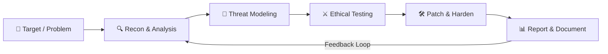

<p align="center">
  
</p>

<p align="center">
  
</p>

<p align="center">
  
  
  
  
</p>

---

## 🤖 Agent Profile

```yaml
agent:
  name: SARFARAZ-AI
  human_operator: Sarfaraz Abbas
  version: 2.0.0
  status: ONLINE 🟢
  role: Cyber Security Researcher
  institution: NED University of Engineering & Technology
  stack: [MERN, Next.js, Python, Cloud, DevSecOps]
  autonomy_level: HIGH
  ethics_policy: "Ethical hacking only. Defence first."
```

---

## 🧠 Core Modules

| Module | Function | Status |
|:--|:--|:--:|
| 🛡️ **Threat Intel Engine** | Vulnerability research, CVE tracking, attack-surface analysis | 🟢 Active |
| 🔍 **Secure Code Reviewer** | Static analysis & OWASP Top 10 review of MERN / Next.js apps | 🟢 Active |
| ⚔️ **Ethical Hacking Lab** | Pentesting in isolated, authorized environments (CTF, labs) | 🟢 Active |
| ☁️ **Cloud Guardian** | AWS / Docker / Firebase hardening & IAM best practices | 🟢 Active |
| 🔁 **DevSecOps Pipeline** | CI/CD with automated security scanning | 🟡 Evolving |
| 🧬 **AI Security Research** | LLM security, prompt injection, agent safety | 🟡 Learning |

---

## ⚙️ Agent Workflow



---

## 📡 Live Telemetry

<p align="center">
  
</p>

<p align="center">
  
  
</p>

<p align="center">
  
</p>

---

## 🌐 Activity Graph

<p align="center">
  
</p>

---

## 🛠️ Tech Arsenal

<p align="center">
  
</p>

**Security toolkit (lab use):** `Kali Linux` · `Burp Suite` · `Nmap` · `Wireshark` · `Metasploit` · `OWASP ZAP`

---

## 🎯 Active Missions

- [x] Build secure MERN-stack applications
- [x] Learn & practice ethical hacking in lab environments
- [ ] Build an AI-assisted vulnerability scanner
- [ ] Publish security research write-ups
- [ ] Contribute to open-source security tools
- [ ] Earn industry certifications (CEH / OSCP / Security+)

---

## 🐍 Cyber Snake (Contribution Stream)

<p align="center">
  
</p>

---

## 💀 Agent Terminal

```bash
┌──(sarfaraz㉿cyber-lab)-[~/agent]
└─$ ./sarfaraz-ai --status --verbose

[✔] Kernel ............ SECURITY-CORE v2.0
[✔] Memory ............ Research notes synced
[✔] Perception ........ Recon engine online
[✔] Reasoning ......... Threat modeling active
[✔] Action ............ Ethical testing enabled
[✔] Guardrails ........ Authorized targets only

> OPERATOR : Sarfaraz Abbas
> ROLE     : Cyber Security Researcher
> UNI      : NED University
> STACK    : MERN + Cloud + DevSecOps
> MISSION  : Build Secure Systems • Ethical Hacking • Digital Defense

> SYSTEM READY 🚀  |  Awaiting next objective...
```

---

## 📬 Establish Connection

<p align="center">
  <a href="https://github.com/sarfarazabbas3"></a>
  <a href="https://www.linkedin.com/in/sarfaraz-abbas-977a47b7/"></a>
</p>

<p align="center">
  <i>"The best defence is understanding the attack."</i>
</p>

<p align="center">
  
</p>
