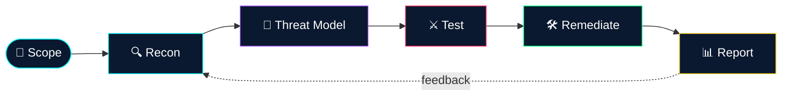

<!-- ═══════════════════════ HERO ═══════════════════════ -->
<div align="center">


<br/>


<br/><br/>

<a href="#-about"></a>
<a href="#-expertise"></a>
<a href="#-tech-stack"></a>
<a href="#-methodology"></a>
<a href="#-github-analytics"></a>
<a href="#-roadmap"></a>
<a href="#-contact"></a>

<br/><br/>


</div>


<!-- ═══════════════════════ ABOUT ═══════════════════════ -->
## 🧠 About

<table align="center" width="100%">
<tr>
<td width="58%" valign="top">

I'm a **Cyber Security Researcher** and **Full Stack Engineer** studying at **NED University**. I build web applications on the MERN stack and then look at them the way an attacker would, so the defences are designed in from day one instead of bolted on later.

My work sits where **secure development**, **ethical hacking** and **cloud / DevSecOps** meet, with a growing interest in the **security of AI systems and agents**.

> 🛡️ *Defence first. Authorized targets only. Disclose responsibly.*

</td>
<td width="42%" valign="top">

```yaml
profile:
  name: Sarfaraz Abbas
  role: Cyber Security Researcher
  university: NED University
  location: Karachi, Pakistan
  stack: [MERN, Next.js, Python]
  infra: [AWS, Docker, Firebase]
  practice: [Pentesting, DevSecOps]
  ethics: Authorized targets only
```

</td>
</tr>
</table>

<!-- ═══════════════════════ EXPERTISE ═══════════════════════ -->
## ⚔️ Expertise

<table align="center" width="100%">
<tr>
<td align="center" width="33%">
<h3>🛡️ Threat Intelligence</h3>
<sub>Vulnerability research, CVE tracking and attack-surface analysis</sub>
</td>
<td align="center" width="33%">
<h3>🔍 Secure Code Review</h3>
<sub>OWASP Top 10 audits for MERN and Next.js applications</sub>
</td>
<td align="center" width="33%">
<h3>⚔️ Penetration Testing</h3>
<sub>CTFs, labs and authorized assessments of web applications</sub>
</td>
</tr>
<tr>
<td align="center" width="33%">
<h3>☁️ Cloud Security</h3>
<sub>AWS, Docker and Firebase hardening, IAM and least privilege</sub>
</td>
<td align="center" width="33%">
<h3>🔁 DevSecOps</h3>
<sub>Security checks inside CI/CD pipelines and automation</sub>
</td>
<td align="center" width="33%">
<h3>🧬 AI Security</h3>
<sub>LLM attack surface, prompt injection and agent safety</sub>
</td>
</tr>
</table>

<!-- ═══════════════════════ TECH STACK ═══════════════════════ -->
## 🛠️ Tech Stack

<div align="center">

| Layer | Technologies |
|:--|:--|
| **Frontend** |  |
| **Backend** |  |
| **Database** |  |
| **Cloud & DevOps** |  |

</div>

**Security toolkit (lab and authorized use only)**

<p>
  
  
  
  
  
  
</p>

<!-- ═══════════════════════ METHODOLOGY ═══════════════════════ -->
## 🧭 Methodology



<!-- ═══════════════════════ ANALYTICS ═══════════════════════ -->
## 📡 GitHub Analytics

<div align="center">


<br/><br/>


<br/><br/>


<br/><br/>


</div>

<!-- ═══════════════════════ ROADMAP ═══════════════════════ -->
## 🎯 Roadmap

<div align="center">

| Goal | Status |
|:--|:--:|
| Build secure MERN-stack applications | ✅ Done |
| Practice ethical hacking in lab environments | ✅ Ongoing |
| AI-assisted vulnerability scanner | 🔄 In progress |
| Publish security research write-ups | 🕐 Planned |
| Contribute to open-source security tools | 🕐 Planned |
| CEH / OSCP / Security+ certifications | 🎯 Target |

</div>

<details>
<summary><b>💀 Open the terminal</b></summary>

```bash
┌──(sarfaraz㉿cyber-lab)-[~/profile]
└─$ ./whoami --verbose

  ███████╗ █████╗ ██████╗ ███████╗ █████╗ ██████╗  █████╗ ███████╗
  ██╔════╝██╔══██╗██╔══██╗██╔════╝██╔══██╗██╔══██╗██╔══██╗╚══███╔╝
  ███████╗███████║██████╔╝█████╗  ███████║██████╔╝███████║  ███╔╝
  ╚════██║██╔══██║██╔══██╗██╔══╝  ██╔══██║██╔══██╗██╔══██║ ███╔╝
  ███████║██║  ██║██║  ██║██║     ██║  ██║██║  ██║██║  ██║███████╗
  ╚══════╝╚═╝  ╚═╝╚═╝  ╚═╝╚═╝     ╚═╝  ╚═╝╚═╝  ╚═╝╚═╝  ╚═╝╚══════╝

[✔] Role ........... Cyber Security Researcher
[✔] University ..... NED University
[✔] Stack .......... MERN + Cloud + DevSecOps
[✔] Mission ........ Build secure systems, hack ethically
[✔] Policy ......... Authorized targets only

> SYSTEM READY 🚀  |  Awaiting next objective...
```

</details>

<!-- ═══════════════════════ CONTACT ═══════════════════════ -->
## 🤝 Contact

<div align="center">

<a href="https://www.linkedin.com/in/sarfaraz-abbas-977a47b7/"></a>
<a href="https://github.com/sarfarazabbas3"></a>

<br/><br/>


</div>
